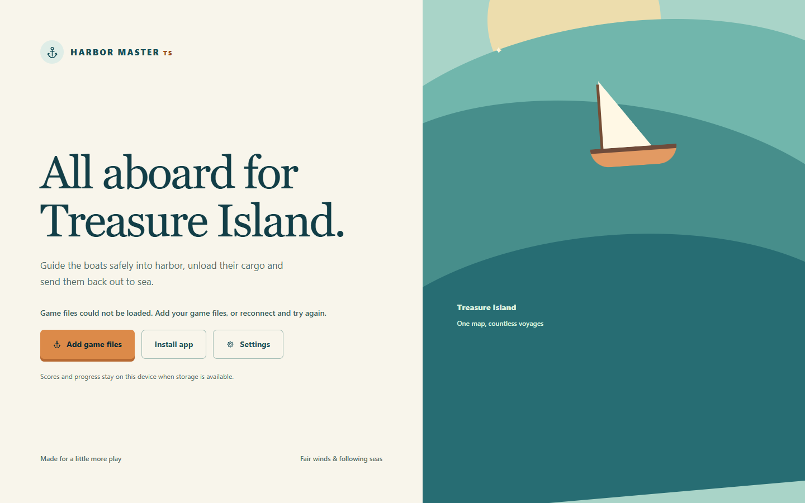

# Harbor Master TS

**This repository contains no proprietary Harbor Master game files: no IPA, original executable, game graphics, levels, music or sound effects. To play, you need your own compatible copy or an asset bundle you are authorised to use.**

A browser-based recreation of Harbor Master HD, written in TypeScript. The original Harbor Master was developed by [Imangi Studios](https://imangistudios.com/). This independent project supports its Treasure Island level and reads the original level, artwork and audio from separately supplied files.

Play with a mouse on a computer or with touch on a phone or tablet. The app can be installed from the browser and, once the app and your own game files are stored on the device, played offline. This is an early recreation: some gameplay details and physical Android hardware still need further verification.

## Screenshots

The home screen before adding game files:



This screenshot shows the project's own interface and illustration. It contains no original game artwork.

## What's included

- A single-player recreation of Treasure Island, with routes drawn from boats to matching docks and back out to sea. Movement, docking, scoring, collisions, arrivals and multitouch are covered by regression tests.
- A touch-friendly, responsive interface with fullscreen controls, keyboard focus indicators, reduced-motion support, and a shared nautical palette and design tokens.
- Local import of a compatible Harbor Master HD IPA or asset-only ZIP, with validation before a replacement can displace a playable game. An optional deployment bundle can load automatically on each device.
- An installable PWA with an offline app shell. Imported game files, preferences, shift statistics and saved shifts are stored locally when browser storage is available.
- Pause and resume, local scores, separate music and sound-effects controls, and an Auto Docking setting. Hiding the app pauses an active shift.
- Automated unit, integration and Playwright browser tests, plus CI on Linux and Windows. The default tests use synthetic fixtures and do not require the original game files.

This project recreates the game independently; it does not run the original executable. Other maps, multiplayer, rewind and the original online services are not implemented. See the [fidelity audit](docs/FIDELITY_AUDIT.md) for what has been verified and what remains approximate.

## Bring your own game files

The repository and standard build contain no original game files. Use your own compatible Harbor Master HD 2.0.1 IPA or an asset-only ZIP that you are authorised to use. Open the app and choose **Add game files** to select it. The files are read on the device and, if storage is available, saved in the browser's IndexedDB; manual import does not upload them.

Once a game is loaded, **Choose a different game file** lets you replace it. An unreadable file or a level without usable docks is rejected before the existing game is replaced. If the browser cannot save the files, the current session can still play and the app explains that the files may need to be added again. Browser storage can be cleared or evicted, and files and progress do not sync between devices.

Never commit an IPA, original game data or generated asset bundles. The local `/public/game/` directory and `*.ipa` are ignored by Git. The standard `npm run build` produces the app shell without game files, even when a bundle has been staged locally.

### Optional deployment bundle

A deployment can include a separately supplied asset-only bundle so a new device loads it automatically. To create one locally from your own IPA, install Python 3 and run:

```sh
python3 tools/build-game-bundle.py /path/to/Harbor-Master-HD.ipa
npm run build:playable
```

On Windows, use `python` instead of `python3` if appropriate. The generator writes `public/game/harbor-hd-assets.zip` locally, containing the Treasure Island map, sprites, music and sound effects. It excludes the original executable, IPA, signatures and unrelated assets. The bundle is proprietary game data and remains outside Git.

Alternatively, let the build create the bundle from an IPA already present in the build environment:

```sh
HARBOR_HD_IPA=/path/to/Harbor-Master-HD.ipa npm run build:playable
```

In Windows PowerShell, set `$env:HARBOR_HD_IPA = 'C:\path\to\Harbor-Master-HD.ipa'` before running `npm run build:playable`. Set `PYTHON` if a different Python executable is needed.

An authorised build environment can instead stage an existing bundle from a controlled location:

```sh
HARBOR_ASSET_BUNDLE_URL=https://your-authorized-host.example/harbor-hd-assets.zip npm run build:playable
```

The URL must use HTTPS, except for localhost, and resolve without a redirect. If the host requires bearer authentication, provide `HARBOR_ASSET_BUNDLE_TOKEN` as a protected environment variable. Do not commit or print private URLs, tokens, IPAs or bundles in CI logs. The staging step validates the bundle before use; `build:playable` fails if it cannot obtain a valid bundle.

The opt-in build places those separately supplied game files in `dist/`. **Anyone who can access a deployment can download its bundled game files**, so configure access to the site and its asset paths appropriately. A subsequent normal `npm run build` removes the bundle from the build output. On first visit, a device downloads and stores the bundle locally; existing usable files take precedence. The service worker caches the app shell, not the game bundle.

## Play and install

Choose **Play Treasure Island**, then draw each boat's route to a matching dock. Once it unloads, draw a route back out to sea. Avoid collisions and deliver as much cargo as you can. Use **Pause** to resume, play again or return to the harbor; a saved shift can be continued from the home screen. Starting a new shift replaces a saved one after confirmation.

Music and sound effects have separate controls and volume settings. Settings also offers Auto Docking. Opening settings during a shift or switching away from the app pauses play until you resume. Fullscreen depends on browser support.

On Android Chrome, open the HTTPS site and use **Install app** or **Add to Home screen** when available. Load the app online and import your files on that device before trying it offline. Progress and preferences are local to the browser's site origin, so a different domain or device has separate saves. For checks on actual hardware, see the [Android device check](docs/ANDROID_DEVICE_CHECK.md).

## Develop

Requires Node.js 20 or newer and npm:

```sh
npm ci
npm run dev
```

Open the local URL printed by Vite and import your own game files through the app. Python 3 is only needed to create a deployment bundle from an IPA. Common checks are:

```sh
npm run typecheck
npm test
npm run build
npm run preview
```

The production build is in `dist/`. Pushing to GitHub does not update a separately hosted site unless a deployment workflow or hosting integration is configured.

## Tests and verification

The default unit and integration suites use synthetic data and need no original game files. They cover gameplay, imports, saves, asset staging and offline updates. To run optional checks against your own local IPA, set `HARBOR_HD_IPA` to its path before running `npm test`.

Browser tests use Playwright. Install Chromium with `npx playwright install chromium`, then run `npm run test:e2e`. This builds the app and tests desktop, Android phone and Android tablet profiles; those profiles are emulations, not physical devices. CI runs the checks on Linux and the unit and integration suites on Windows.

The project-local [Playwright best-practices skill](.agents/skills/playwright-best-practices/SKILL.md) comes from [currents-dev/playwright-best-practices-skill](https://github.com/currents-dev/playwright-best-practices-skill) at revision `0b75b5835a87de1fdd202ba965f3bc5a27738fdf`. The [Hallmark skill](.agents/skills/hallmark/SKILL.md), used for design audits and requested redesigns, comes from [Nutlope/hallmark](https://github.com/Nutlope/hallmark) at revision `04977e15f3dfd6ee4b74c887dac3eb52665d6c92`. Each skill includes its MIT licence.

## Licence and acknowledgements

The independently written project source is available under the [MIT licence](LICENSE). Third-party dependencies and included skills retain their own licences.

Harbor Master was created by [Imangi Studios](https://imangistudios.com/); thanks to the original developers for the game that inspired this project. The original game and its assets belong to their respective rights holders and are not covered by this project's licence. This repository does not include those proprietary files, and a player's local import or optional deployment bundle is supplied separately.
